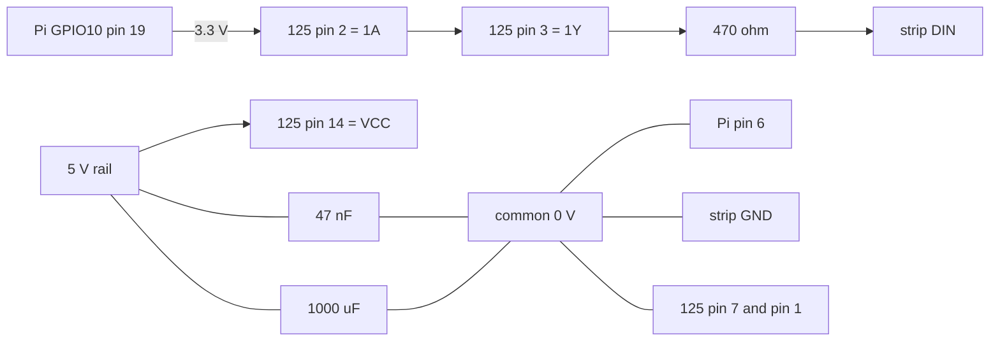

# Hardware guide

This is the physical build: a 288-pixel WS2812 word clock on a 300-LED strip, driven through a 74AHCT125 level shifter. Fadecandy is not in the signal path.

Two hosts are candidates. The Raspberry Pi 3B drives the strip over SPI0; the ESP32-C3-DevKit-RUST-1 drives it over RMT. The level shifter, series resistor, capacitors, common ground, strip, and 5 V supply are common to both. The host is selected by the measured spike in design D16; this guide documents the Pi path in detail because it is the incumbent, and the C3 path is added after the decision.

The guide covers what to buy, how to wire it, how to enable the output, how to prove the build works, and how to roll back. The design rationale lives in `openspec/changes/replace-fadecandy-with-rust/design.md`, decisions D3, D16, and D17; this page is the build instruction.

## Bill of materials

Reused from the Fadecandy build: Raspberry Pi 3B, MeanWell 5 V supply, 300-LED WS2812 strip, and the Fadecandy board (rollback path only). For the ESP32-C3 path, replace the Pi 3B, microSD card, and 1×40 header with the ESP32-C3-DevKit-RUST-1; the level shifter, passives, strip, and supply are unchanged.

| Part | Qty | BerryBase SKU | Unit price |
| :--- | ---: | :--- | ---: |
| SN74AHCT125N, DIL-14 | 2 | `SN74AHCT125N` | €0.54 |
| IC socket, 14-pin, THT | 1 | `ICS-14` | €0.96 |
| 470 Ω, 1/4 W, 1 % | 5 | `MSW470R.25` | €0.05 |
| 47 nF, 50 V ceramic, THT 2.54 mm | 5 | `KEK47N50VCC` | €0.05 |
| 1000 µF, 16 V radial, 105 °C | 2 | `ELK1M16VAWH` | €0.29 |
| Perfboard, 5×7 cm | 1 | `PBS-5X7` | €0.30 |
| Dupont leads, 40-pin M-F | 1 | `DUPONT-FM` | €1.60 |
| Pin header, 1×40 | 1 | `PINH-1X40P` | €0.50 |
| microSD, 32 GB or larger | 1 | `619659173067` | €26.90 |
| Raspberry Pi Pico H, RP2040, headers | 1 | `RPI-PICO-H` | €5.50 |
| ESP32-C3-DevKit-RUST-1 (alternative host) | 1 | — | owned |
| Fuse holder, 5×20 mm (optional) | 1 | `SIH-32A2A` | €1.40 |

Prices and availability were checked on 2026-10-24. BerryBase has no minimum order value, ships DHL within Germany for €4.95, and waives shipping from €200.

The 47 nF decoupling capacitor is a substitution, not the nominal value. A 100 nF part is equally correct and is stocked by Reichelt as `KERKO 100N` for €0.04; nothing else in the build changes.

The 74HCT245 is a documented fallback if the AHCT125 cannot be sourced: Reichelt stocks it in DIP-20 as `74HCT 245` for €1.15. Wire `DIR` to 5 V, `/OE` to GND, `A1` to GPIO10, `B1` through the 470 Ω to strip DIN, and leave the other channels unconnected but tied off.

## Wiring

The diagram below is the Pi path. On the ESP32-C3 path, replace `GPIO10` with a free, non-strapping header GPIO and use the RMT peripheral instead of SPI0; the level-shifter pinout, 470 Ω resistor, capacitors, and common ground do not change. Choose the GPIO from the board schematic and avoid the USB and boot-strapping pins.

Signal path, pin by pin:

```
                                  +5 V  (LED supply, existing MeanWell)
                                    │
                        ┌───────────┴───────────┐
                        │                       │
                     ┌──┴───┐               ┌───┴────┐
                     │47 nF │               │1000 µF │
                     └──┬───┘               └───┬────┘
                        │                       │
 Raspberry Pi 3B        │   SN74AHCT125N        │        WS2812 strip
 ┌──────────────┐       │  ┌───────────────┐    │        ┌──────────┐
 │ GPIO10  19   ├───────┼─►│ 2  1A    1Y  3 ├────┴─[470Ω]►│ DIN      │
 │              │ 3.3 V │  │               │             │          │
 │ GND      6   ├───┐   │  │ 14 VCC        │             │          │
 └──────────────┘   │   │  │ 7  GND        │             └────┬─────┘
                    │   │  │ 1  1OE        │                  │
                    │   │  │ 5,9,12  2A/3A/4A               │
                    │   │  │ 4,10,13 2OE/3OE/4OE            │
                    │   │  └───────────────┘                  │
                    └───┴────── common 0 V ───────────────────┘
```

Topology at a glance:



Connection list:

| From | To | Note |
| :--- | :--- | :--- |
| Pi GPIO10, physical pin 19 | 125 pin 2 (1A) | 3.3 V SPI data |
| 125 pin 3 (1Y) | 470 Ω, then strip DIN | 5 V data |
| 125 pin 1 (1OE) | GND | enable gate 1 |
| 125 pin 14 (VCC) | LED 5 V | same rail as the strip |
| 125 pin 7 (GND) | common 0 V | join Pi pin 6 and supply 0 V |
| 125 pins 5, 9, 12 (2A, 3A, 4A) | GND | unused inputs, never float |
| 125 pins 4, 10, 13 (2OE, 3OE, 4OE) | GND | unused enables |
| 47 nF | VCC ↔ GND | close to pins 14 and 7 |
| 1000 µF | strip 5 V ↔ 0 V | at the first LED, mind the polarity |

Unused CMOS inputs must not float: tie the three spare gate inputs to ground and their enables low. Leaving them open causes oscillation and needless current.

Put the 470 Ω as close to pin 3 as the layout allows. Keep the data lead short; if it must be longer than roughly 30 cm, run it as a twisted pair with a ground return.

Do not add a bidirectional MOSFET shifter such as the Adafruit BSS138 board. Its 10 kΩ pull-ups produce 1–2 µs edges, which cannot encode the 0.4 µs and 0.8 µs WS2812 pulses.

## Pin choice

GPIO10 on physical pin 19 is SPI0 MOSI. Use it.

That pin gives you the kernel SPI engine with DMA, the device node `/dev/spidev0.0`, and the driver's default device, with no PWM or audio contention and no change when the Pi is replaced by a 4 or 5.

Do not wire CE0 (GPIO8, pin 24) or CE1 (GPIO7, pin 26). They are chip selects, the driver may toggle them, and they have no role in a WS2812 stream.

If SPI0 is ever unavailable, the fallback is SPI1 MOSI on GPIO20, physical pin 38, enabled with `dtoverlay=spi1-1cs` and used as `/dev/spidev1.0`. Avoid GPIO0 and GPIO1 (ID EEPROM) and GPIO14 and GPIO15 (serial console).

## Enable SPI (Pi path)

On the ESP32-C3 path there is no SPI device to enable; the RMT peripheral is configured in firmware. The instructions below apply only when the Pi is selected.

Start from a fresh Raspberry Pi OS Lite 64-bit image.

1. Edit `/boot/firmware/config.txt` and ensure the line `dtparam=spi=on` is present.
2. Reboot.
3. Add the service user to the SPI group: `sudo usermod -aG spi,gpio,i2c suhlig`.
4. Log out and back in, then verify the device and the group:

```bash
ls -l /dev/spidev0.0
groups
```

`/dev/spidev0.0` must exist and `spi` must appear in the group list. If the node is missing, check that `dtparam=spi=on` is uncommented and that the Pi actually booted the edited file.

## Before the first power-up

Work through this list with the power off.

- Continuity between Pi pin 6, 125 pin 7, the strip's 0 V, and the supply's 0 V.
- 5 V only on 125 pin 14 and on the strip's V+; never on the Pi's 5 V pin or on the 3.3 V rail.
- Pin 1 is grounded and pins 4, 10 and 13 are grounded.
- Pins 5, 9 and 12 are grounded, not floating.
- The 1000 µF electrolytic is the right way round: the stripe and the short lead go to 0 V.
- The 470 Ω is between pin 3 and DIN, not between the supply and the strip.
- The strip's data direction: DIN at the connector you are driving, DOUT at the far end.

Leave the Pi's own supply separate from the LED supply. Do not power the Pi from the LED rail without a protected 5 V path.

## First light

Power the strip, then the Pi. With the daemon not yet running, verify with a short SPI run rather than by connecting a live data line by hand.

Expected results once the SPI output is working:

- Every LED lights; a 300-LED strip driven with a 288-pixel frame shows the last 12 dark.
- Pure red, green and blue requests produce red, green and blue with no swapped channels. WS2812 expects green-red-blue order on the wire.
- A full-strip wipe completes in about 9 ms at 2.4 MHz.

If nothing lights, check in this order: the strip has 5 V and 0 V at its own connector; the level shifter has 5 V on pin 14 and ground on pin 7; GPIO10 actually toggles; the 470 Ω is not open; the data line reaches DIN and not DOUT.

If the first LED lights and later ones do not, the problem is downstream of the first LED: a broken segment, a reversed connector, or a supply sag. If the strip flickers or the first pixel shows random colours, suspect the ground return and the bulk capacitor before suspecting the software.

## Test patterns and physical mapping

The daemon provides `wordclock test-pattern` with walking-pixel, row-colour, primary-colour and all-on modes. It is implemented in task 4.6; until it lands, use any equivalent SPI test program.

Run the modes in this order and write down what you see.

1. Primary colours: confirms colour order, so WS2812 GRB versus RGB.
2. Walking pixel from 0 to the configured count: confirms the physical path and shows at which index the strip actually ends.
3. Row colour: confirms orientation and whether the strip is wired row-major, column-major or serpentine.
4. All-on: confirms the supply copes and the whole chain is addressed.

Record in the configuration whether the mapping is identity, serpentine or otherwise, whether row 0 is at the top, and whether the 12 LEDs beyond pixel 287 are physically present. Default to identity only if the walking pixel proves it.

## Diagnostics with a Pico

A Raspberry Pi Pico H flashed with `sigrok-pico` gives an open logic analyzer for this build: PulseView plus libsigrokdecode's `rgb_led_ws281x` decoder.

1. Hold BOOTSEL while connecting USB, then drag `pico_sdk_sigrok/release/pico_baseline.uf2` onto the `RPI-RP2` volume.
2. Start a current PulseView. Version 0.4.2 does not support this driver.
3. Select the `raspberrypi-pico` driver and the board's CDC serial port, which is `/dev/cu.usbmodem*` on macOS and `/dev/ttyACM0` on Linux.
4. Capture at 24 MHz on one channel, which resolves the 0.4 µs and 0.8 µs pulses with plenty of margin.

The firmware caps digital capture at 120 Msps, limited by the 120 MHz PIO clock. Neither RP2040 nor RP2350 changes that, so any Pico works.

WARNING: RP2040 and RP2350 GPIO are 3.3 V only and are not 5 V tolerant. Clip to GPIO10 or to pin 2 (1A). Never connect the shifted 5 V signal at pin 3 (1Y) or at strip DIN directly to a Pico pin; use a 10 kΩ/10 kΩ divider if the 5 V side must be observed. A dedicated analyzer with adjustable thresholds does not have this limitation.

What to look for in a capture: a 0.4 µs high pulse for a zero bit, 0.8 µs for a one bit, and a low period that keeps the bit period near 1.25 µs. At an SPI clock of 2.4 MHz each WS2812 bit is encoded as three SPI bits, so a zero appears as `100` and a one as `110`.

## Power and grounding

The strip and the level shifter share the LED 5 V rail; the Pi keeps its own supply. The grounds must be common, because the level shifter's input is referenced to the Pi's ground and its output to the strip's.

Only the lit words draw current, so the average load is far below the strip's worst case, but the supply must still cover the all-on test without dropping out. If the clock is powered from one point, feed the strip from the supply end and not through the Pi's header.

The 1000 µF sits at the first LED and absorbs the current step when a frame changes. The 47 nF sits at the shifter and decouples the switching edges. Neither is optional in practice: without them the first pixel misbehaves intermittently in ways that look like software bugs.

If a fuse is fitted, put it in the 5 V feed to the strip, sized for the supply and the wire, not for the average clock load.

## Rollback

For the Pi path, keep the old SD card and Fadecandy board available as described below. For the ESP32-C3 path, keep the previous OTA image or a USB-reflashable release, and keep the legacy Pi/Fadecandy clock as the ultimate fallback until the stability window closes.

The old SD card and the Fadecandy board are the rollback path until the SPI build has passed the rollback drill and two weeks of stable operation.

1. Power down the Pi and the strip.
2. Move the data lead from the level shifter output back to the Fadecandy channel 0 output.
3. Remove the level shifter's 5 V feed if it is separately wired.
4. Swap in the original SD card.
5. Power up and confirm the legacy Ruby clock renders the current minute.

Do not retire the old card or the Fadecandy board before that two-week window has passed. A card swap is the recoverable path; a code revert is not.
