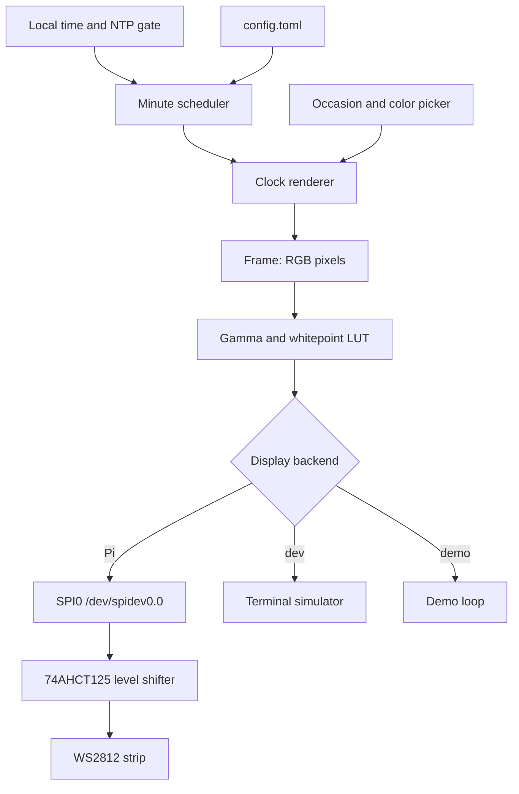

# Design

## Context

The current production clock is a Raspberry Pi 3 Model B Rev 1.2 running Raspbian GNU/Linux 13 (trixie) 32-bit (`armv7l`, kernel `6.18.39+rpt-rpi-v7`) with 920 MiB RAM and a 64 GB SD card. It has been stable for almost ten years. Ruby 4.0.1 is installed. `fcserver` has been running continuously for seven months and a Fadecandy board is present on USB (`1d50:607a`). A cron entry as user `suhlig` runs `bundle exec ~/apps/wordclock/current/exe/wordclock` every minute, all day, with no night blackout.

The only reason the host is 32-bit is the prebuilt `fcserver-rpi` binary. SPI is currently disabled (`#dtparam=spi=on` in `/boot/firmware/config.txt`). The `spi`, `gpio`, and `i2c` groups exist and `suhlig` is in all three. NTP is active (`ntpsec`) and `timedatectl show -p NTPSynchronized --value` returns `yes`.

The legacy implementation is small and well tested. Its production contract is:

- A single 288-character stripe, 16 rows of 18 characters, with logical pixel index equal to character index. The maximum index actually lit is 268; indices 269–287 are never used by current phrases. A frame lights between 11 and 39 pixels.
- `Clock24#pixels` maps local hour and minute to a strictly increasing list of indices. `Clock24.words` returns the concatenated characters for diagnostics.
- The wording is a hybrid: relative German before noon (`VIERTEL ZWÖLF`, `HALB EINS`) and 24-hour exact time from noon onward (`DREIZEHN UHR FÜNFZEHN`). Minutes that do not land on a five-minute mark fall back to `<hour> UHR <minute>`. This is preserved exactly in this change; cleanup is a later change.
- On a regular day, one random color is sampled per process. Because cron starts a new process every minute, the clock changes color every minute. On carnival, configured birthdays, and New Year party windows, each lit pixel gets its own color. Ash Wednesday and the New Year hangover use fixed grey 64,64,64.
- The color table has 922 XKCD colors, not 932.
- Fadecandy applies whitepoint scaling, then a gamma 2.5 curve with `linearCutoff = 0` and `linearSlope = 1`, then temporal dithering in firmware. The whitepoint is `1.0,1.0,1.0`.
- The clock is visible 24/7. There is no blackout and no shutdown symbol in production.

Fadecandy is dead upstream and cannot be patched. The Ruby LED ecosystem is thin and old; there is no maintained equivalent of `rppal` for this job. A Rust daemon removes the 32-bit constraint, the Ruby runtime, the OPC hop, and the dead binary, while keeping the clock's visible behavior.

## Goals / Non-Goals

**Goals:**

- Preserve the current visible output exactly: the same words, the same pixel indices, the same color cadence, and the same gamma-corrected colors.
- Ship a single aarch64 Linux binary that runs on 64-bit Raspberry Pi OS and drives the strip over SPI.
- Keep the simulator as a first-class, hardware-free development and test surface.
- Make deployment reproducible from a blank SD card and keep a tested rollback to the current SD card and Fadecandy board.
- Leave clean extension points for the deferred ideas in the Reminders list.

**Non-Goals:**

- No new user-facing features: no smooth fades, animations, night dimming or blackout, countdowns, calendar integration, web UI, Prometheus, MQTT, sensors, buttons, or shutdown symbol in this change.
- No wording cleanup. The quirks stay until after the port, in a separate change.
- No OPC compatibility layer. External OPC clients are not part of the clock.
- No support for multiple strips, multiple Fadecandy-style devices, or per-device mapping.
- No reuse of Fadecandy firmware, USB protocol, WebSocket UI, or server configuration semantics beyond the color pipeline.
- No change to the physical LED wiring until the test pattern confirms the order.

## Decisions

### D1: Rewrite in Rust in a new repository

The rewrite lives in `github.com/suhlig/wordclock-rs`, created public and dual-licensed MIT OR Apache-2.0. `github.com/suhlig/wordclock` stays untouched as the legacy reference and the source of the golden fixture. This keeps the migration oracle stable and avoids a mixed Ruby/Rust tree during the cutover.

Rust was chosen over Go and Ruby because the LED and Raspberry Pi crates are maintained (`rppal`, `ws2812-spi`), the binary is dependency-free at runtime, the core logic is pure and easy to test, and the user is comfortable with Rust. Ruby remains the behavioral oracle, not the target runtime.

### D2: Keep the Pi 3B and move to 64-bit Raspberry Pi OS Lite

The Pi 3B is sufficient: the clock logic is trivial, the SPI write is about 9 ms per frame, and the 1 GiB of RAM is ample. The 32-bit constraint disappears with `fcserver`. Reflash a new SD card with Raspberry Pi OS Lite 64-bit (trixie), keep the old card untouched, and treat the Pi hardware as stable until it shows a fault. A Pi Zero 2 W would also work but is not needed; a Pi 4 or Pi 5 adds power, heat, and cost without a benefit for 288 pixels.

### D3: Drive the strip from SPI0 with an external level shifter

Fadecandy currently provides both the USB interface and the 5 V level shifting (SN74HCT245 on the Fadecandy board). The replacement uses the Pi's SPI0 MOSI on GPIO10 (physical pin 19), a 74AHCT125 (or 74HCT245) level shifter powered from the LED 5 V supply, a 330–470 Ω series resistor at the first LED, and a common ground between the Pi, the level shifter, and the LED supply.

| Connection | Pi / part | Strip / supply |
| :--- | :--- | :--- |
| Data | GPIO10, physical pin 19 (SPI0 MOSI) | 74AHCT125 pin 2 (1A) |
| Shifted data | 74AHCT125 pin 3 (1Y) | 470 Ω, then strip DIN |
| Output enable | 74AHCT125 pin 1 (1OE) | GND |
| Logic supply | 74AHCT125 pin 14 (VCC) | LED 5 V |
| Ground | 74AHCT125 pin 7 (GND) | common ground |
| Decoupling | 100 nF | across 74AHCT125 VCC/GND |
| Bulk | 1000 µF, 10 V | across strip 5 V/GND at the first LED |

The 74HCT245 alternative uses DIR = VCC, OE = GND, A1 = GPIO10, B1 = strip DIN through the same resistor, VCC = 5 V, GND = common. Do not power the Pi from the LED supply without a proper protected 5 V path. Keep the data lead short; use a twisted pair with ground if it must be longer. The WS2812/WS2812B data threshold is about 0.7 × VDD, so 3.3 V is marginal and the level shifter is mandatory.

The strip in use is WS2812, not WS2811B. Both use the same 800 kHz NZR protocol and the same 0.7 × VDD input threshold, so the wiring, SPI encoding, and software are unchanged. Do not substitute the Adafruit BSS138 bidirectional shifter: its 10 kΩ pull-ups produce roughly 1–2 µs edges, which cannot encode the 0.4/0.8 µs WS2812 pulses. Use the 74AHCT125 or 74HCT245.

SPI is preferred over Pi PWM/DMA because it needs no kernel or audio workarounds, is portable to Pi 4 and Pi 5, and keeps the `rpi_ws281x` C dependency out of the project. The trade-off is that an external level shifter is required either way; Fadecandy already supplied one.

BOM additions:

| Part | Quantity | Purpose |
| :--- | ---: | :--- |
| 74AHCT125 (or 74HCT245) | 1 | 3.3 V to 5 V data level shift |
| 470 Ω resistor | 1 | Series termination at first LED |
| 100 nF ceramic capacitor | 1 | Level-shifter decoupling |
| 1000 µF 10 V electrolytic | 1 | Strip input bulk capacitance |
| Dupont wires / header / perfboard | as needed | Wiring |
| 32 GB or larger microSD | 1 | New 64-bit OS, old card retained |
| Optional logic analyzer | 1 | Verify SPI timing and data integrity |
| Optional 5 A fuse | 1 | LED supply protection |

The existing 300-LED WS2812 strip, MeanWell 5 V supply, Pi 3B, and Fadecandy board (rollback) are reused.

### D4: Run as a long-running systemd service

Cron-per-minute cannot hold state, animate, gate on NTP, or expose health. The daemon owns the display, computes a frame at each local minute boundary, and refreshes the current frame once per second. The service runs as the non-root `wordclock` user with `spi`, `gpio`, and `i2c` supplementary groups. The unit uses `Restart=always`, `RestartSec=2`, `After=network-online.target time-sync.target`, `Wants=network-online.target time-sync.target`, `NoNewPrivileges=true`, `ProtectSystem=strict`, `ProtectHome=true`, and `PrivateTmp=true`. It does not use `PrivateDevices`, because that would hide `/dev/spidev0.0`.

### D5: Keep the core pure and put hardware behind a display trait

The architecture separates the time-to-frame logic from the output backend:



Proposed module layout:

- `clock`: the 288-character stripe, word tables, `pixels`, `words`, and the exact legacy lookup.
- `color`: `Rgb`, `NamedColor`, the 922-entry XKCD table, occasion rules, and the gamma/whitepoint LUT.
- `frame`: `Frame` with logical and physical pixel counts.
- `display`: a `Display` trait, an SPI backend behind a `hardware` Cargo feature, a terminal backend, and a null backend for tests.
- `daemon`: scheduler, NTP gate, signal handling, and logging.
- `config`: TOML loading and validation.
- `main`: `clap` subcommands for `run`, `sim`, `demo`, `test-pattern`, and `--version`.

The simulator and core tests build on macOS without the `hardware` feature. The Pi release builds with `--features hardware`.

### D6: Crate choices

Use the maintained, small crates that fit the job:

- `rppal` 0.22 with the `hal` feature for SPI, GPIO, and future I2C.
- `ws2812-spi` 0.5 with the `std` feature, using its hosted variant and the GRB color order.
- `smart-leds-trait` for the RGB write trait expected by `ws2812-spi`.
- `chrono` and `chrono-tz` for local time and DST tests; `computus` 2 for Easter dates.
- `clap` 4, `tokio` 1, `tracing`, `tracing-subscriber`, `serde`, `toml`, `thiserror`, and `anyhow`.
- `rand` or `fastrand` for XKCD sampling, with an injectable RNG for deterministic tests.
- Dev: `rstest`, `serde_json`, `assert_cmd`, `predicates`, and `tempfile`.

No `axum`, `rumqttc`, `prometheus`, or sensor crates in this change. They are future changes behind the same daemon.

### D7: SPI output details

Enable SPI with `dtparam=spi=on` in `/boot/firmware/config.txt`, reboot, and verify `/dev/spidev0.0`. Open SPI0, slave select 0, SPI mode 0, at 3 MHz (the `ws2812-spi` accepted range is 2–3.8 MHz). At 3 MHz a 288-pixel frame takes about 9.2 ms; at 2.4 MHz it takes about 11.5 ms. Build with `--release`; timing-sensitive bit generation must not be left at debug optimization. Write the full physical strip length, padding beyond 288 with black. The `ws2812-spi` crate emits GRB order and appends reset bytes.

If the first LED shows wrong colors while the rest are correct, suspect the data voltage or the level shifter, not the software. If pixels are intermittently wrong, suspect gaps between SPI transfers or a too-slow clock; a logic analyzer is the right tool. If SPI proves unreliable on this Pi, the fallback order is: lower the SPI clock, try the other SPI mode, then use a dedicated RP2040/ESP32 LED controller over serial/network, and only then consider Pi PWM/DMA.

### D8: Preserve the color pipeline, not necessarily Fadecandy's dithering

The correction is the Fadecandy curve with `linearCutoff = 0` and `linearSlope = 1`:

```text
input = channel / 255.0 * whitepoint[channel]
output = pow(input, 2.5)
corrected = round(output * 255.0)
```

Precompute a 256-entry `u8` table at startup. Expected values: 0 → 0, 32 → 1, 64 → 8, 96 → 22, 128 → 46, 160 → 80, 192 → 125, 224 → 184, 255 → 255. The whitepoint is `1.0,1.0,1.0`, so it is an identity step in production and remains configurable.

Fadecandy also temporally dithers at roughly 400 Hz. At a 1 Hz static refresh, its dithering is not reproduced; for the clock's static 8-bit colors the visible difference should be negligible. Implement error-diffusion dithering only if a side-by-side hardware comparison shows a real difference, and then evaluate flicker at the daemon's refresh rate before enabling it. Keyframe interpolation is irrelevant because the new daemon renders continuously and does not receive discrete frames over OPC.

### D9: Preserve the per-minute color cadence and occasion semantics

The legacy process lifetime is one minute, so `ColorPicker#choose`'s cache produces one uniform color per minute. The daemon must reproduce that explicitly:

- On a regular day, sample one color when the minute changes and use it for every lit pixel until the next minute. Do not resample on the 1 Hz refresh.
- On carnival, birthdays, and New Year party windows, sample one color per lit pixel when the minute changes and hold that frame until the next minute. Do not turn the 1 Hz refresh into a rave.
- On Ash Wednesday and New Year hangover, use grey 64,64,64.
- Evaluate occasions in this order: carnival, Ash Wednesday, configured birthdays, New Year party, New Year hangover, regular day. The default birthday list is 13 January, 10 March, 8 April, 18 July, and 31 December.
- Carnival is 11 November 11:11–23:59, Rosenmontag (Easter − 48 days), and Faschingsdienstag (Easter − 47 days). Ash Wednesday is Easter − 46 days. New Year party is 1 January 00:00–03:59; hangover is 1 January 04:00–23:59.

### D10: Use the legacy implementation as a golden oracle

Generate `fixtures/minutes.json` from the legacy Ruby code before porting. It contains 1,440 entries with `time`, `pixels`, and `words`. The verified fixture generated on 2026-10-24 has 503,999 bytes and SHA-256 `33824892ca69303599c72cf6c7651a0f1d0bb9111ae312ef51dc943278df454e`. The stripe checksum is `aed1c38776d7be5a34e40eb376dce927d4a80efb6f7781a874a8eaa7adfe65b8`; the normalized XKCD list `hex name` has 922 lines and SHA-256 `9ac5913dccc2200cd46e2b5c4f61d05a5779d8f934b99788c652b34b3ee75d0e`.

Generation command in the legacy repository:

```bash
ruby -Ilib -rjson -rtime -rword_clock/clock_24 -e '
fixtures = []
0.upto(23) do |h|
  0.upto(59) do |m|
    time = Time.new(2026, 1, 1, h, m)
    pixels = WordClock::Clock24.new(time).pixels
    fixtures << { time: format("%02d:%02d", h, m), pixels: pixels, words: WordClock::Clock24.words(pixels) }
  end
end
File.write("fixtures/minutes.json", JSON.pretty_generate(fixtures))
'
```

The Rust test loads the fixture and asserts equality for every minute. Additional tests cover the color occasions with a fake sampler, the gamma vectors, the frame padding, and the simulator's deterministic output. The golden fixture is the authority; do not "fix" a mismatch by changing expectations unless the human explicitly approves a behavior change.

### D11: Gate the first render on NTP

The Pi 3 has no RTC, so a boot before NTP can show 1970 or a stale time. On startup the daemon checks `timedatectl show -p NTPSynchronized --value`; if it is not `yes`, it keeps the strip off or neutral and logs the wait every 30 seconds. Once synchronized, it renders within one refresh interval. This is a deliberate robustness deviation from the legacy cron behavior, approved during planning. The daemon still renders from the local system clock if the network later goes away.

### D12: Build in CI and deploy with Ansible

GitHub Actions runs `cargo fmt --check`, `cargo clippy --all-targets -- -D warnings`, and `cargo test --all-targets` on the default (hardware-free) features. A cross job builds `aarch64-unknown-linux-gnu` with the `hardware` feature using `cross`, strips the binary, and packages it with the systemd unit and example config. A tag `v*` publishes the artifact and SHA-256. Ansible pins the version, verifies the checksum, installs the binary to `/usr/local/bin/wordclock`, the config to `/etc/wordclock/config.toml`, and the unit to `/etc/systemd/system/wordclock.service`, creates the `wordclock` user and groups, enables SPI, and removes `fcserver`, the Ruby role, and the cron entries. The release profile uses `opt-level = 3`, `lto = true`, `codegen-units = 1`, and `strip = true`.

### D13: Verify the physical order before trusting identity mapping

The current code assumes logical index order equals physical order, and the clock looks correct, but the strip's wiring has not been inspected recently. The first hardware step is `wordclock test-pattern`: pure red, green, and blue; a walking pixel from 0 to the configured count; and a row pattern with a distinct color per physical row. The operator records whether the strip is row-major, serpentine, or column-major, whether the first row is at the top, and whether the extra 12 LEDs beyond 288 are connected. Only after that is the production mapping fixed. If the order is not identity, add a configurable logical-to-physical map and test it with the same pattern before running the clock.

### D14: Rollback is a card swap, not a code revert

Keep the current SD card untouched. Keep the Fadecandy board and USB cable. If the new build fails, power off, swap the old SD card back in, reconnect Fadecandy to the strip, and boot. The legacy cron and `fcserver` are still installed there. Do not erase or repurpose the old card until the new clock has run for at least two weeks, including a reboot, an NTP-delayed boot, and a network outage.

## Risks / Trade-offs

| Risk | Mitigation |
| :--- | :--- |
| Physical wiring is not identity or is serpentine | Run the walking-pixel and row test patterns before writing the clock frame; add a mapping if needed. |
| 3.3 V data is marginal or the first LED misbehaves | Use the 74AHCT125/74HCT245 level shifter, short data lead, common ground, 470 Ω series resistor, and bulk capacitance. |
| SPI timing gaps cause random pixels | Use the hosted/pre-rendered path, build with `--release`, test at 3 MHz, and verify with a logic analyzer; fall back to a lower clock or an RP2040/ESP32 controller. |
| Gamma or dithering difference is visible | Compare fixed-color frames side by side with Fadecandy; the gamma LUT is exact, and dithering is added only if the comparison justifies it. |
| Physical strip has 300 LEDs but only 288 are logical | Write 300 pixels with the last 12 black; confirm with the test pattern and make both counts configurable. |
| Old Pi or SD card fails during the migration | Use a new SD card, keep the old card as rollback, and back up the current image before reflashing. |
| NTP gate leaves the clock dark after a network failure | Log the wait every 30 seconds; the gate is configurable, and the legacy behavior remains the rollback. |
| Cross-compiled binary does not match the Pi's glibc | Use `cross` with the aarch64 GNU target, test the artifact on the Pi before cutover, and keep an on-Pi `cargo build --release` fallback. |
| Rust rewrite diverges from Ruby behavior | The 1,440-minute golden fixture, ported occasion tests, and the simulator parity check are the gate. |
| Two repositories drift apart | The legacy repo is frozen after the fixture is generated; the new repo links to it and copies the hardware and migration docs. |
| Host key for `wordclock` changed since the last connection | Verify the new fingerprint with the human before trusting it; do not disable host-key checking in automation. |
| Scope creep from the Reminders list | This change is parity-only; every new idea becomes a separate OpenSpec change after the cutover. |

## References

- Legacy behavior: `github.com/suhlig/wordclock/lib/word_clock/clock_24.rb`, `color_picker.rb`, `xkcd_color_sampler.rb`, `terminal/`.
- Legacy executables: `exe/wordclock`, `exe/wordclock-simulator`, `exe/showoff`.
- Legacy specs: `spec/unit/word_clock/`, `spec/integration/`, `spec/shared_examples_for_word_clock.rb`.
- Fadecandy color pipeline: `server/src/fcdevice.cpp` around `writeColorCorrection`, and `firmware/fc_pixel.cpp` around `updatePixel`.
- Fadecandy hardware: `pcb/fc64x8/fc64x8.sch` confirms the SN74HCT245 level shifter.
- Fadecandy handoff: `doc/fadecandy-replacement-handoff.markdown` in the legacy repository.
- Infrastructure: `uhlig-it/infrastructure/playbooks/machines/wordclock.yml`, `roles/wordclock/launch.yml`, `roles/fadecandy/`.
- Crates: `rppal` 0.22.1, `ws2812-spi` 0.5.1, `computus` 2.0.0.
- Current live system: Pi 3B Rev 1.2, Raspbian 13 trixie 32-bit, kernel 6.18.39+rpt-rpi-v7, Ruby 4.0.1, no Rust or Go, 920 MiB RAM, 64 GB SD, 52 GB free, `fcserver` active, cron every minute, SPI disabled, NTP synchronized via ntpsec.

## Deferred Reminders backlog

The Reminders list "Wordclock" mixes completed hardware work with open ideas. Nothing below is part of this change. The open ideas are recorded here so the architecture does not close doors, and each becomes its own OpenSpec proposal after the parity cutover.

- Observability: a web log of timestamp and color with SSE or WebSocket refresh; Prometheus metrics for current R, G, B, and luminance; MQTT publish of color hex, name, and timestamp; reading luminosity from Prometheus and filtering colors.
- User-facing behavior: smooth fade between minutes; night dimming or blackout; New Year and birthday countdowns; birthday colors from a calendar; a Matrix animation; particle explosion on PIR trigger; rear demo buttons; a powered-off symbol on shutdown.
- Sensors and hardware: current sensor, voltage logging, backplane temperature, TSL2561 lux, PIR, battery/RTC support, and button wiring.
- Operations: NTP configuration in Ansible, apt auto-update, log rotation, SSH and keyboard setup, and backup to `git.uhlig.it`.
- Superseded or obsolete: `clockwork`/`rufus-scheduler` (the daemon owns scheduling), Docker deployment (a static binary with direct SPI access is simpler and avoids device passthrough), minute LEDs, seconds LEDs, Blinkenlights, the icon tool, and the old `exe/off` blackout hack.

The NTP startup gate is the one Reminders item promoted into this change, because the Pi 3 has no RTC and a wrong time is worse than a dark clock. Completed hardware items such as the PIR, lux sensor, and brightness control are not assumed to be absent; they are simply not wired into v1.
