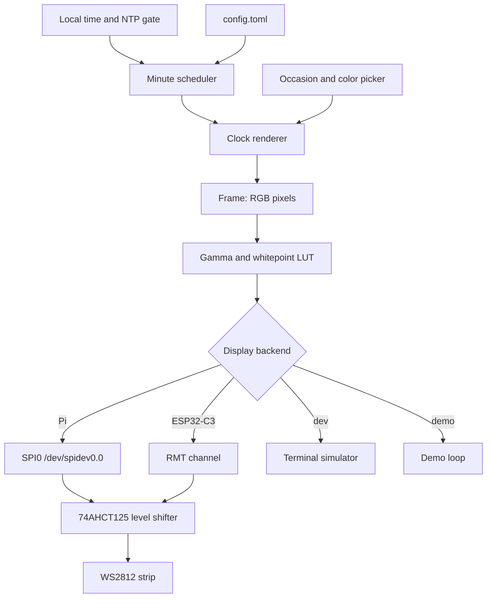

# Design

## Context

The current production clock is a Raspberry Pi 3 Model B Rev 1.2 running Raspbian GNU/Linux 13 (trixie) 32-bit (`armv7l`, kernel `6.18.39+rpt-rpi-v7`) with 920 MiB RAM and a 64 GB SD card. It has been stable for almost ten years. Ruby 4.0.1 is installed. `fcserver` has been running continuously for seven months and a Fadecandy board is present on USB (`1d50:607a`). A cron entry as user `suhlig` runs `bundle exec ~/apps/wordclock/current/exe/wordclock` every minute, all day, with no night blackout.

The only reason the host is 32-bit is the prebuilt `fcserver-rpi` binary. SPI is currently disabled (`#dtparam=spi=on` in `/boot/firmware/config.txt`). The `spi`, `gpio`, and `i2c` groups exist and `suhlig` is in all three. NTP is active (`ntpsec`) and `timedatectl show -p NTPSynchronized --value` returns `yes`.

The legacy implementation is small and well tested. Its production contract is:

- A single 288-character stripe, 16 rows of 18 characters, with logical pixel index equal to character index. The maximum index actually lit is 268; indices 269–287 are never used by current phrases. A frame lights between 11 and 39 pixels.
- `Clock24#pixels` maps local hour and minute to a strictly increasing list of indices. `Clock24.words` returns the concatenated characters for diagnostics.
- The wording is a hybrid: relative German before noon (`VIERTEL ZWÖLF`, `HALB EINS`) and 24-hour exact time from noon onward (`DREIZEHN UHR FÜNFZEHN`). Minutes that do not land on a five-minute mark fall back to `<hour> UHR <minute>`. This is preserved exactly in this change; cleanup is a later change.
- On a regular day, one random color is sampled per process. Because cron starts a new process every minute, the clock changes color every minute. On carnival, configured birthdays, and New Year party windows, each lit pixel gets its own color. Ash Wednesday and the New Year hangover use fixed grey 64,64,64.
- The color table has 922 XKCD colors, not 932.
- Fadecandy applies whitepoint scaling, then a gamma 2.5 curve with `linearCutoff = 0` and `linearSlope = 1`, then temporal dithering in firmware. The whitepoint is `1.0,1.0,1.0`.
- The clock is visible 24/7. There is no blackout and no shutdown symbol in production.

Fadecandy is dead upstream and cannot be patched. The Ruby LED ecosystem is thin and old; there is no maintained equivalent of `rppal` for this job. A Rust implementation removes the 32-bit constraint, the Ruby runtime, the OPC hop, and the dead binary, while keeping the clock's visible behavior.

The host is a second, separate question. The current Pi 3B is the incumbent and has ample headroom, but the workload is 288 pixels updated once per minute, which also fits a single ESP32-C3. An ESP32-C3-DevKit-RUST-1 and a Pi Zero 2 W are already available, so the choice can be made on measurements instead of assumptions. The core, simulator, and fixture are therefore kept host-independent, and exactly one host is selected before hardware provisioning.

## Goals / Non-Goals

**Goals:**

- Preserve the current visible output exactly: the same words, the same pixel indices, the same color cadence, and the same gamma-corrected colors.
- Keep the clock core, color pipeline, and simulator independent of the host and its output transport, so the same fixture-tested logic runs on either candidate.
- Select exactly one host on measured evidence: the Raspberry Pi 3B with 64-bit Raspberry Pi OS Lite and SPI0, or the ESP32-C3-DevKit-RUST-1 with RMT and Wi-Fi/SNTP.
- Make an orderly stop unmistakable on the strip on hosts that support an orderly stop, so an outdated minute is never read as the current time.
- Keep the simulator as a first-class, hardware-free development and test surface.
- Make deployment reproducible for the selected host and keep a tested rollback to the current SD card and Fadecandy board, which are temporary: the board leaves the signal path once the rollback window closes and is not part of the target hardware.
- Leave clean extension points for the deferred ideas in the Reminders list.

**Non-Goals:**

- No new user-facing features beyond the shutdown pattern: no smooth fades, animations, night dimming or blackout, countdowns, calendar integration, web UI, Prometheus, MQTT, sensors, or buttons in this change.
- No simultaneous production deployment of both hosts. Exactly one host is selected and maintained; the other path is a spike or a rollback.
- No wording cleanup. The quirks stay until after the port, in a separate change.
- No OPC compatibility layer. External OPC clients are not part of the clock.
- No support for multiple strips, multiple Fadecandy-style devices, or per-device mapping.
- No reuse of Fadecandy firmware, USB protocol, WebSocket UI, or server configuration semantics beyond the color pipeline.
- No change to the physical LED wiring until the test pattern confirms the order.

## Decisions

### D1: Rewrite in Rust in a new repository

The rewrite lives in `github.com/suhlig/wordclock-rs`, created public and dual-licensed MIT OR Apache-2.0. `github.com/suhlig/wordclock` stays untouched as the legacy reference and the source of the golden fixture. This keeps the migration oracle stable and avoids a mixed Ruby/Rust tree during the cutover.

Rust was chosen over Go and Ruby because the LED and Raspberry Pi crates are maintained (`rppal`, `ws2812-spi`), the binary is dependency-free at runtime, the core logic is pure and easy to test, and the user is comfortable with Rust. Ruby remains the behavioral oracle, not the target runtime.

### D2: Treat the Pi 3B as the incumbent host candidate

The Pi 3B is sufficient: the clock logic is trivial, the SPI write is about 9 ms per frame, and the 1 GiB of RAM is ample. The 32-bit constraint disappears with `fcserver`. If the Pi is selected, reflash a new SD card with Raspberry Pi OS Lite 64-bit (trixie), keep the old card untouched, and treat the Pi hardware as stable until it shows a fault. A Pi Zero 2 W would also work but is not needed; a Pi 4 or Pi 5 adds power, heat, and cost without a benefit for 288 pixels. The ESP32-C3 alternative is evaluated in D16.

### D3: Drive the strip from SPI0 with an external level shifter on the Pi

This section describes the Pi path. The ESP32-C3 path uses RMT and is described in D17; both paths share the level shifter, series resistor, and grounding rules.

Fadecandy currently provides both the USB interface and the 5 V level shifting (SN74HCT245 on the Fadecandy board). The replacement uses the Pi's SPI0 MOSI on GPIO10 (physical pin 19), an SN74AHCT125N in DIL-14 powered from the LED 5 V supply, a 470 Ω series resistor at the first LED, and a common ground between the Pi, the level shifter, and the LED supply.

| Connection | Pi / part | Strip / supply |
| :--- | :--- | :--- |
| Data | GPIO10, physical pin 19 (SPI0 MOSI) | 74AHCT125 pin 2 (1A) |
| Shifted data | 74AHCT125 pin 3 (1Y) | 470 Ω, then strip DIN |
| Output enable | 74AHCT125 pin 1 (1OE) | GND |
| Logic supply | 74AHCT125 pin 14 (VCC) | LED 5 V |
| Ground | 74AHCT125 pin 7 (GND) | common ground |
| Decoupling | 47 nF (100 nF nominal) | across 74AHCT125 VCC/GND |
| Bulk | 1000 µF, 16 V (10 V minimum) | across strip 5 V/GND at the first LED |
| Unused inputs | 74AHCT125 pins 5, 9, 12 (2A, 3A, 4A) | GND |
| Unused enables | 74AHCT125 pins 4, 10, 13 (2OE, 3OE, 4OE) | GND |

The 74HCT245 alternative uses DIR = VCC, OE = GND, A1 = GPIO10, B1 = strip DIN through the same resistor, VCC = 5 V, GND = common; it is only worth using if a source for the AHCT125 cannot be found, because it needs more wiring for the same one data line. Tie the inputs of the three unused gates to GND and their enables low rather than leaving any CMOS input floating. Do not power the Pi from the LED supply without a proper protected 5 V path. Keep the data lead short; use a twisted pair with ground if it must be longer. The WS2812/WS2812B data threshold is about 0.7 × VDD, so 3.3 V is marginal and the level shifter is mandatory.

The strip in use is WS2812, not WS2811B. Both use the same 800 kHz NZR protocol and the same 0.7 × VDD input threshold, so the wiring, SPI encoding, and software are unchanged. Do not substitute the Adafruit BSS138 bidirectional shifter: its 10 kΩ pull-ups produce roughly 1–2 µs edges, which cannot encode the 0.4/0.8 µs WS2812 pulses. Use the 74AHCT125 or 74HCT245.

SPI is preferred over Pi PWM/DMA because it needs no kernel or audio workarounds, is portable to Pi 4 and Pi 5, and keeps the `rpi_ws281x` C dependency out of the project. The trade-off is that an external level shifter is required either way; Fadecandy already supplied one.

BOM additions:

| Part | Quantity | Purpose |
| :--- | ---: | :--- |
| SN74AHCT125N, DIL-14 | 2 | 3.3 V to 5 V data level shift, one spare |
| IC socket, 14-pin, THT | 1 | Swap the buffer without desoldering |
| 470 Ω, 1/4 W, 1 % | 5 | Series termination at the first LED |
| 47 nF, 50 V ceramic, THT 2.54 mm | 5 | Level-shifter decoupling |
| 1000 µF, 16 V radial, 105 °C | 2 | Strip input bulk capacitance |
| Perfboard, 5×7 cm | 1 | Level-shifter carrier |
| 40-pin Dupont M-F leads and 1×40 header | 1 each | Pi header to carrier, data lead |
| microSD, 32 GB or larger | 1 | New 64-bit OS, old card retained |
| Raspberry Pi Pico H (RP2040, headers), sigrok-pico firmware | 1 | Logic analyzer for SPI timing and data integrity |
| Optional 5×20 mm fuse holder and 5 A fuse | 1 | LED supply protection |

### Sourcing

Stock and prices were verified on 2026-10-24. Every part except the 74HCT245 fallback comes from a single BerryBase order.

| Item | SKU | Price |
| :--- | :--- | ---: |
| SN74AHCT125N, DIL-14 | `SN74AHCT125N` | €0.54 |
| IC socket 14-pin | `ICS-14` | €0.96 |
| 470 Ω 1/4 W | `MSW470R.25` | €0.05 |
| 47 nF 50 V ceramic | `KEK47N50VCC` | €0.05 |
| 1000 µF 16 V | `ELK1M16VAWH` | €0.29 |
| Perfboard 5×7 cm | `PBS-5X7` | €0.30 |
| Dupont 40-pin M-F leads | `DUPONT-FM` | €1.60 |
| Pin header 1×40 | `PINH-1X40P` | €0.50 |
| SanDisk High Endurance 32 GB microSD | `619659173067` | €26.90 |
| Fuse holder 5×20 mm | `SIH-32A2A` | €1.40 |
| Raspberry Pi Pico H, RP2040, headers | `RPI-PICO-H` | €5.50 |

BerryBase ships DHL inside Germany for €4.95 and waives shipping from €200; there is no minimum order value. The electronics without the SD card and the fuse holder total about €11. Supplier availability decides the chip: BerryBase lists the SN74AHCT125N but no 74HCT245, Reichelt lists the 74HCT245 in DIP-20 (€1.15) but no 74AHCT125 at all, and Pollin lists neither. Splitting the order would cost more in shipping than the difference between the parts, so the single-shop BOM uses the AHCT125, which also needs the least wiring for one data line. The 100 nF decoupling value was not in stock at BerryBase; 47 nF is a drop-in for a gate switching at 800 kHz to 3 MHz, and Reichelt's `KERKO 100N` is the fallback if the nominal value is required.

### Diagnostics

The logic analyzer is a Raspberry Pi Pico H running the `sigrok-pico` firmware, which was merged into mainline sigrok in 2023. Flash `pico_sdk_sigrok/release/pico_baseline.uf2` by holding BOOTSEL while connecting USB, then select the `raspberrypi-pico` driver in PulseView over the board's CDC serial port. PulseView 0.4.2 and sigrok-cli 0.7.2 do not support the driver; install a newer build. The firmware caps digital capture at 120 Msps, limited by the 120 MHz PIO clock, and switches to USB streaming for deep captures, so neither the RP2040 nor the newer RP2350 is a bottleneck for an 800 kHz WS2812 stream. libsigrokdecode's `rgb_led_ws281x` decoder is available for the capture.

RP2040 and RP2350 GPIO are 3.3 V only and not 5 V tolerant. Clip to GPIO10 or the buffer input on pin 2 (1A). Never connect the shifted 5 V signal at pin 3 (1Y) or at strip DIN directly to a Pico pin; use a 10 kΩ/10 kΩ divider if the 5 V side must be observed.

The existing 300-LED WS2812 strip, MeanWell 5 V supply, and Pi 3B are reused. The Fadecandy board is not part of the target hardware: it stays connected only as the rollback path until the new SPI output has passed the rollback drill and two weeks of stable operation, then it is removed and retired.

### D4: Run as a long-running service on the selected host

On the Pi, cron-per-minute cannot hold state, animate, gate on NTP, or expose health, so the daemon owns the display, computes a frame at each local minute boundary, and refreshes the current frame once per second. The service runs as the non-root `wordclock` user with `spi`, `gpio`, and `i2c` supplementary groups. The unit uses `Restart=always`, `RestartSec=2`, `After=network-online.target time-sync.target`, `Wants=network-online.target time-sync.target`, `TimeoutStopSec=10`, `NoNewPrivileges=true`, `ProtectSystem=strict`, `ProtectHome=true`, and `PrivateTmp=true`. It does not use `PrivateDevices`, because that would hide `/dev/spidev0.0`.

On the ESP32-C3 there is no systemd. The equivalent is a firmware loop with a hardware watchdog, a Wi-Fi reconnect loop, an SNTP synchronization gate, and OTA updates (D18).

### D5: Keep the core pure and put hardware behind a display trait

The architecture separates the time-to-frame logic from the output backend:



Proposed module layout:

- `clock`: the 288-character stripe, word tables, `pixels`, `words`, and the exact legacy lookup. No host or transport dependency.
- `color`: `Rgb`, `NamedColor`, the 922-entry XKCD table, occasion rules, and the gamma/whitepoint LUT. No host dependency.
- `frame`: `Frame` with logical and physical pixel counts. No host dependency.
- `display`: a `Display` trait, a terminal backend, a null backend for tests, and one hardware backend per selected host: SPI on the Pi, RMT on the ESP32-C3.
- `daemon`: scheduler, time gate, signal handling, and logging on the Pi; the firmware loop on the ESP32-C3.
- `config`: TOML loading on the Pi, NVS/LittleFS or build-time defaults on the ESP32-C3.
- `main`: `clap` subcommands for `run`, `sim`, `demo`, `test-pattern`, and `--version` on the host; a firmware entry point on the ESP32-C3.

The simulator and core tests build on macOS without any hardware feature. Until the host is selected, the single crate keeps the `hardware` feature for the Pi SPI backend. If the ESP32-C3 is selected, split the repository into a workspace: `wordclock-core` (`no_std` + `alloc`), `wordclock-host` (simulator, Pi daemon, CLI), and `wordclock-esp32` (firmware). The core, fixture, and simulator tests move unchanged.

### D6: Crate choices

Use the maintained, small crates that fit the job:

- Host: `rppal` 0.22 with the `hal` feature for Pi SPI, GPIO, and future I2C; `ws2812-spi` 0.5 with the `std` feature, using its hosted variant and the GRB color order; `smart-leds-trait` for the RGB write trait.
- ESP32-C3: `esp-hal` with an RMT WS2812 driver (`esp-hal-smartled` or equivalent), `esp-wifi` for Wi-Fi, `esp-backtrace` and `esp-println` for diagnostics, and `espflash` for flashing. `esp-idf-svc` is the std alternative if OTA, SNTP, and logging convenience outweigh the larger binary.
- `chrono` and `chrono-tz` for local time and DST tests; `computus` 2 for Easter dates. `chrono-tz` stays on the host; the ESP32-C3 uses a filtered timezone database or a fixed `Europe/Berlin` offset with the EU DST rule to conserve flash.
- Host only: `clap` 4, `tokio` 1, `tracing`, `tracing-subscriber`, `serde`, `toml`, `thiserror`, and `anyhow`. The core modules must not depend on these.
- `rand` or `fastrand` for XKCD sampling, with an injectable RNG for deterministic tests.
- Dev: `rstest`, `serde_json`, `assert_cmd`, `predicates`, and `tempfile`.

No `axum`, `rumqttc`, `prometheus`, or sensor crates in this change. They are future changes behind the same daemon.

### D7: SPI output details on the Pi

Enable SPI with `dtparam=spi=on` in `/boot/firmware/config.txt`, reboot, and verify `/dev/spidev0.0`. Open SPI0, slave select 0, SPI mode 0, at 3 MHz (the `ws2812-spi` accepted range is 2–3.8 MHz). At 3 MHz a 288-pixel frame takes about 9.2 ms; at 2.4 MHz it takes about 11.5 ms. Build with `--release`; timing-sensitive bit generation must not be left at debug optimization. Write the full physical strip length, padding beyond 288 with black. The `ws2812-spi` crate emits GRB order and appends reset bytes.

If the first LED shows wrong colors while the rest are correct, suspect the data voltage or the level shifter, not the software. If pixels are intermittently wrong, suspect gaps between SPI transfers or a too-slow clock; a logic analyzer is the right tool. If SPI proves unreliable on this Pi, the fallback order is: lower the SPI clock, try the other SPI mode, then use a dedicated RP2040/ESP32 LED controller over serial/network, and only then consider Pi PWM/DMA.

### D8: Preserve the color pipeline, not necessarily Fadecandy's dithering

The correction is the Fadecandy curve with `linearCutoff = 0` and `linearSlope = 1`:

```text
input = channel / 255.0 * whitepoint[channel]
output = pow(input, 2.5)
corrected = round(output * 255.0)
```

Precompute a 256-entry `u8` table at startup. Expected values: 0 → 0, 32 → 1, 64 → 8, 96 → 22, 128 → 46, 160 → 80, 192 → 125, 224 → 184, 255 → 255. The whitepoint is `1.0,1.0,1.0`, so it is an identity step in production and remains configurable.

Fadecandy also temporally dithers at roughly 400 Hz. At a 1 Hz static refresh, its dithering is not reproduced; for the clock's static 8-bit colors the visible difference should be negligible. Implement error-diffusion dithering only if a side-by-side hardware comparison shows a real difference, and then evaluate flicker at the daemon's refresh rate before enabling it. Keyframe interpolation is irrelevant because the new daemon renders continuously and does not receive discrete frames over OPC.

### D9: Preserve the per-minute color cadence and occasion semantics

The legacy process lifetime is one minute, so `ColorPicker#choose`'s cache produces one uniform color per minute. The daemon must reproduce that explicitly:

- On a regular day, sample one color when the minute changes and use it for every lit pixel until the next minute. Do not resample on the 1 Hz refresh.
- On carnival, birthdays, and New Year party windows, sample one color per lit pixel when the minute changes and hold that frame until the next minute. Do not turn the 1 Hz refresh into a rave.
- On Ash Wednesday and New Year hangover, use grey 64,64,64.
- Evaluate occasions in this order: carnival, Ash Wednesday, configured birthdays, New Year party, New Year hangover, regular day. The default birthday list is 13 January, 10 March, 8 April, 18 July, and 31 December.
- Carnival is 11 November 11:11–23:59, Rosenmontag (Easter − 48 days), and Faschingsdienstag (Easter − 47 days). Ash Wednesday is Easter − 46 days. New Year party is 1 January 00:00–03:59; hangover is 1 January 04:00–23:59.

### D10: Use the legacy implementation as a golden oracle

Generate `fixtures/minutes.json` from the legacy Ruby code before porting. It contains 1,440 entries with `time`, `pixels`, and `words`. The verified fixture generated on 2026-10-24 has 503,999 bytes and SHA-256 `33824892ca69303599c72cf6c7651a0f1d0bb9111ae312ef51dc943278df454e`. The stripe checksum is `aed1c38776d7be5a34e40eb376dce927d4a80efb6f7781a874a8eaa7adfe65b8`; the normalized XKCD list `hex name` has 922 lines and SHA-256 `9ac5913dccc2200cd46e2b5c4f61d05a5779d8f934b99788c652b34b3ee75d0e`.

Generation command in the legacy repository:

```bash
ruby -Ilib -rjson -rtime -rword_clock/clock_24 -e '
fixtures = []
0.upto(23) do |h|
  0.upto(59) do |m|
    time = Time.new(2026, 1, 1, h, m)
    pixels = WordClock::Clock24.new(time).pixels
    fixtures << { time: format("%02d:%02d", h, m), pixels: pixels, words: WordClock::Clock24.words(pixels) }
  end
end
File.write("fixtures/minutes.json", JSON.pretty_generate(fixtures))
'
```

The Rust test loads the fixture and asserts equality for every minute. Additional tests cover the color occasions with a fake sampler, the gamma vectors, the frame padding, and the simulator's deterministic output. The golden fixture is the authority; do not "fix" a mismatch by changing expectations unless the human explicitly approves a behavior change.

Word separation is geometric, not encoded in `words`. The fixture's `words` field concatenates the lit stripe characters and contains no spaces. On a row, `lookup` skips one cell after each word, so there is always at least one dark cell between words; when a word ends at column 17, the next word starts at column 0 of the next row and the line break is the separator. The only fixture cases where a contiguous lit run crosses a row boundary are `HALB` (indices 140–143) followed by `SIEBEN` (144–149) at 06:20, 06:25, 06:30, 06:35, and 06:40. That run reads `HALBSIEBEN` in `words` but is correct on the 16×18 grid. Preserve this behavior; do not add space characters or space pixels.

### D11: Gate the first render on NTP

The Pi 3 has no RTC, so a boot before NTP can show 1970 or a stale time. On startup the daemon checks `timedatectl show -p NTPSynchronized --value`; if it is not `yes`, it keeps the strip off or neutral and logs the wait every 30 seconds. Once synchronized, it renders within one refresh interval. This is a deliberate robustness deviation from the legacy cron behavior, approved during planning. The daemon still renders from the local system clock if the network later goes away.

On the ESP32-C3 the same gate applies, but the signal is the SNTP client's synchronized state after Wi-Fi association. A device that cannot reach the network stays neutral and retries; it does not display the ESP32's reset time.

### D12: Build in CI and deploy with Ansible

GitHub Actions runs `cargo fmt --check`, `cargo clippy --all-targets -- -D warnings`, and `cargo test --all-targets` on the default (hardware-free) features. For the Pi, a cross job builds `aarch64-unknown-linux-gnu` with the `hardware` feature using `cross`, strips the binary, and packages it with the systemd unit and example config. A tag `v*` publishes the artifact and SHA-256. Ansible pins the version, verifies the checksum, installs the binary to `/usr/local/bin/wordclock`, the config to `/etc/wordclock/config.toml`, and the unit to `/etc/systemd/system/wordclock.service`, creates the `wordclock` user and groups, enables SPI, and removes `fcserver`, the Ruby role, and the cron entries. The release profile uses `opt-level = 3`, `lto = true`, `codegen-units = 1`, and `strip = true`.

For the ESP32-C3, CI builds `riscv32imc-unknown-none-elf` with `espflash` (or `esp-idf-svc`), publishes a versioned firmware image and checksum, and records the partition/OTA layout. Deployment is a flash or an OTA update, not Ansible. The host decision selects exactly one of these release pipelines; the other is not maintained.

### D13: Verify the physical order before trusting identity mapping

The current code assumes logical index order equals physical order, and the clock looks correct, but the strip's wiring has not been inspected recently. The first hardware step is a test-pattern mode: pure red, green, and blue; a walking pixel from 0 to the configured count; and a row pattern with a distinct color per physical row. The operator records whether the strip is row-major, serpentine, or column-major, whether the first row is at the top, and whether the extra 12 LEDs beyond 288 are connected. The same frame builders are used on the Pi and the ESP32-C3; only the transport changes. Only after that is the production mapping fixed. If the order is not identity, add a configurable logical-to-physical map and test it with the same pattern before running the clock.

### D14: Rollback is a card swap, not a code revert

Keep the current SD card untouched. Keep the Fadecandy board and USB cable available as the rollback path. If the new Pi build fails, power off, swap the old SD card back in, reconnect Fadecandy to the strip, and boot. The legacy cron and `fcserver` are still installed there. Do not erase or repurpose the old card, and do not remove the board, until the new clock has run for at least two weeks, including a reboot, an NTP-delayed boot, and a network outage. After that window, remove the board and USB cable from the installation and retire them; the SPI wiring is the permanent data path.

If the ESP32-C3 is selected, the rollback is the previous firmware image via OTA or a USB reflash, plus the still-powered legacy Pi/Fadecandy clock as the ultimate fallback. Do not retire the Pi path until the C3 has run the same two-week stability window.

### D15: Show an explicit shutdown pattern instead of clearing to black

The legacy clock has no shutdown indication. On a service stop or an orderly reboot the last frame stays latched on the strip, so a stale minute can be read as the current time. Clearing to black fixes the stale time but is indistinguishable from an unpowered, dead, or dimmed clock. On the Pi, the daemon therefore writes a uniform dim white fill of all 288 logical pixels as its final frame on SIGTERM, using the raw value 32,32,32 and bypassing the gamma table, because the gamma curve would map 32 to 1 and make the pattern nearly invisible. A uniform fill cannot encode a word or a time, and the dim level stays visible without glare at night.

WS2812 latches its last frame, so the pattern survives process exit and remains until power is cut. During an orderly `systemctl stop`, `reboot`, or `poweroff`, systemd delivers SIGTERM and the unit's `TimeoutStopSec=10` bounds the write; the default shutdown dependencies stop the unit before power is lost. The guarantee is best effort: SIGKILL, a crash, or a power cut leaves the last clock frame, and the daemon cannot react. This promotes the deferred powered-off symbol in its smallest useful form, as an explicit exception to the parity-only scope.

The ESP32-C3 has no equivalent orderly stop. On power loss it cannot render a final frame; the strip keeps the last clock frame until power returns. The firmware therefore treats this as a documented limitation, shows a neutral frame after boot until SNTP synchronization completes, and offers no false shutdown guarantee. A manual `blank` command may be added later, but it is not part of this change.

### D16: Decide the host with a measured ESP32-C3 spike

The host is chosen after the core and simulator exist, not before. Two candidates are carried through the plan: the incumbent Raspberry Pi 3B and the ESP32-C3-DevKit-RUST-1 that is already available. The gate runs after tasks 2 and 3 and before any hardware provisioning. The spike is time-boxed and answers the questions that paper cannot:

- Does RMT drive the real 288-pixel strip reliably through the 74AHCT125, with no visible gaps between RMT chunks?
- What is the boot-to-first-frame time, and how long is a full frame?
- Does Wi-Fi associate, synchronize via SNTP, and recover from a network loss without showing a stale or reset time?
- Does the `Europe/Berlin` DST rule match `chrono-tz` on the host across the fixture and future transition dates?
- How much flash and RAM remain after the timezone rule, Wi-Fi, and OTA partitions?
- How much effort are flashing, OTA, and rollback compared with Ansible and a systemd unit?

The comparison is recorded in this design and in `tasks.md`. The working audit, toolchain notes, and measurement log live in `docs/esp32-c3-spike.md`. If the spike is inconclusive, the Pi 3B wins by default: it is the incumbent and its rollback is already proven.

| Criterion | Raspberry Pi 3B | ESP32-C3-DevKit-RUST-1 |
| :--- | :--- | :--- |
| CPU / RAM | 4× Cortex-A53, 1 GiB | single RISC-V, 400 KiB SRAM |
| Storage | SD card | typically 4 MiB flash, no SD |
| Network | Ethernet and 2.4 GHz Wi-Fi | 2.4 GHz Wi-Fi only |
| Time source | ntpsec/systemd-timesyncd | SNTP over Wi-Fi |
| LED transport | SPI0, 2.4–3 MHz | RMT, 800 kHz NZR |
| Runtime | Linux + systemd | bare-metal `esp-hal` or `esp-idf-svc` |
| Deployment | Ansible + systemd | USB flash or OTA |
| Updates | apt + Ansible | OTA with rollback partition |
| Orderly stop | SIGTERM shutdown pattern | no SIGTERM; last frame remains |
| Power / size | higher / larger | lower / small |
| Main risk | SD and OS maintenance | Wi-Fi, flash pressure, OTA |

Measured on 2026-10-25 with the combined gate firmware (real core plus the `Europe/Berlin` rule, Wi-Fi/SNTP, a 288-pixel RMT frame, and an OTA partition table). The host choice itself is task 4.8.

| Measurement | ESP32-C3-DevKit-RUST-1 |
| :--- | :--- |
| Boot to first (neutral) frame | 246 ms |
| Boot to first SNTP / clock frame | 2.3 s clean; 11.3 s after an abrupt reset with a stale access-point session |
| Full 288-pixel frame | 8.1–8.2 ms typical, 10.5 ms worst case (all white) |
| RMT refill overhead | About 0.7–0.8 ms per frame, about 5 µs average per refill; the worst single gap still needs the analyzer |
| Flash with timezone + OTA | 556,496 of 1,966,080 bytes (28.3%) in one OTA slot |
| RAM | 54,432-byte heap peak of 103,184, plus a 27,656-byte static RMT buffer |
| Wi-Fi reconnect | 5.1 s including the 5 s backoff; association itself about 0.1 s |

The only outstanding hardware question is the worst-case RMT inter-chunk gap, which needs the Pico analyzer and the level shifter in task 4.3. Every other D16 criterion has measured headroom; the Pi 3B remains the default if the analyzer shows a gap near the WS2812 reset threshold.

### D17: ESP32-C3 output and time

If the ESP32-C3 is selected, the output uses one RMT TX channel at 800 kHz NZR with the WS2812 GRB order, sending all 288 logical pixels plus black padding. Choose a free, non-strapping header GPIO after checking the board schematic; avoid the USB and boot-strapping pins. The data line still goes through the 74AHCT125 (or 74HCT245), the 470 Ω series resistor, and a common ground; the C3 is 3.3 V and the strip expects a 5 V-referenced data high. The RMT driver may emit the frame in chunks; verify with the Pico analyzer that the inter-chunk gap stays well below the WS2812 reset threshold, otherwise the strip will latch mid-frame.

Time comes from Wi-Fi association and SNTP. The firmware gates the first frame on a successful synchronization, retries indefinitely if the network is unavailable, re-synchronizes periodically, and keeps the hardware watchdog fed. Only `Europe/Berlin` is required for v1; use a fixed offset plus the EU DST rule, or a filtered timezone database, and keep the full `chrono-tz` database out of the firmware unless the flash budget proves otherwise. Configuration (strip length, GPIO, timezone, birthdays, refresh interval, gate) lives in NVS/LittleFS or is compiled into the image; there is no TOML file and no systemd. Logging goes to USB serial/defmt during development and to a network log or OTA-readable buffer in production.

There is no orderly shutdown. Power loss leaves the last frame latched, and the firmware cannot write a dim fill first. The post-boot neutral/NTP-gated frame is the only mitigation in this change.

### D18: ESP32-C3 lifecycle and deployment

The spike also decides between `esp-hal` (bare-metal, `no_std`, smaller and deterministic) and `esp-idf-svc` (std, FreeRTOS, easier SNTP/OTA/logging but a larger binary and more C dependencies). Whichever wins, the firmware needs a hardware watchdog, a Wi-Fi reconnect state machine, periodic SNTP resync, a visible version string, and OTA with an A/B partition and rollback. Wi-Fi credentials are provisioned into NVS and are never committed to the repository. Deployment is a documented `espflash` command or an OTA upload with a checksum; there is no Ansible, no non-root service user, and no single-writer lock because the device runs one firmware image. Rollback is the previous OTA image or a USB reflash, with the legacy Pi/Fadecandy clock as the ultimate fallback.

## Risks / Trade-offs

| Risk | Mitigation |
| :--- | :--- |
| Physical wiring is not identity or is serpentine | Run the walking-pixel and row test patterns before writing the clock frame; add a mapping if needed. |
| 3.3 V data is marginal or the first LED misbehaves | Use the 74AHCT125/74HCT245 level shifter, short data lead, common ground, 470 Ω series resistor, and bulk capacitance on both host paths. |
| SPI timing gaps cause random pixels | Use the hosted/pre-rendered path, build with `--release`, test at 3 MHz, and verify with a logic analyzer; fall back to a lower clock or an RP2040/ESP32 controller. |
| RMT chunk gaps reset the strip mid-frame | Measure the gap with the Pico analyzer, use a streaming/chunked RMT driver, and keep the largest gap far below the WS2812 reset threshold; if it cannot be met, reject the C3 path. |
| ESP32-C3 Wi-Fi is weak or unavailable at the clock | Use 2.4 GHz coverage at the final location, test association and SNTP after a network loss, and keep the Pi/Ethernet path as the fallback if the site is marginal. |
| ESP32-C3 flash is too small for the timezone data and OTA slots | Restrict timezone data to `Europe/Berlin`, measure the release image, and reject the C3 path if the OTA partition cannot hold it with headroom. |
| ESP32-C3 cannot show a shutdown pattern on power loss | Document the limitation, keep the post-boot neutral/NTP gate, and do not claim a shutdown guarantee for the C3 path. |
| OTA update fails and bricks the device | Use A/B partitions with rollback, verify the image checksum before activation, and keep USB reflash and the legacy Pi/Fadecandy clock as recovery paths. |
| `esp-hal`/`esp-idf` API churn breaks the firmware | Pin the toolchain and crate versions, keep the core host-independent, and time-box the spike before committing to the C3 path. |
| Two host paths drift and both rot | Select exactly one host after D16 and execute only that path's hardware, daemon, release, and deployment tasks. |
| Gamma or dithering difference is visible | Compare fixed-color frames side by side with Fadecandy; the gamma LUT is exact, and dithering is added only if the comparison justifies it. |
| Physical strip has 300 LEDs but only 288 are logical | Write 300 pixels with the last 12 black; confirm with the test pattern and make both counts configurable. |
| Old Pi or SD card fails during the migration | Use a new SD card, keep the old card as rollback, and back up the current image before reflashing. |
| NTP gate leaves the clock dark after a network failure | Log the wait every 30 seconds; the gate is configurable, and the legacy behavior remains the rollback. |
| Cross-compiled binary does not match the Pi's glibc | Use `cross` with the aarch64 GNU target, test the artifact on the Pi before cutover, and keep an on-Pi `cargo build --release` fallback. |
| Rust rewrite diverges from Ruby behavior | The 1,440-minute golden fixture, ported occasion tests, and the simulator parity check are the gate. |
| Two repositories drift apart | The legacy repo is frozen after the fixture is generated; the new repo links to it and copies the hardware and migration docs. |
| Host key for `wordclock` changed since the last connection | Verify the new fingerprint with the human before trusting it; do not disable host-key checking in automation. |
| Service stop or orderly shutdown leaves a stale minute | On the Pi, the daemon writes the uniform dim shutdown pattern on SIGTERM, and the unit's stop timeout bounds the write before power loss. On the ESP32-C3 the limitation is documented and the post-boot frame is neutral until time is synchronized. |
| Scope creep from the Reminders list | This change is parity-only plus the shutdown pattern; every other new idea becomes a separate OpenSpec change after the cutover. |

## References

- Legacy behavior: `github.com/suhlig/wordclock/lib/word_clock/clock_24.rb`, `color_picker.rb`, `xkcd_color_sampler.rb`, `terminal/`.
- Legacy executables: `exe/wordclock`, `exe/wordclock-simulator`, `exe/showoff`.
- Legacy specs: `spec/unit/word_clock/`, `spec/integration/`, `spec/shared_examples_for_word_clock.rb`.
- Fadecandy color pipeline: `server/src/fcdevice.cpp` around `writeColorCorrection`, and `firmware/fc_pixel.cpp` around `updatePixel`.
- Fadecandy hardware: `pcb/fc64x8/fc64x8.sch` confirms the SN74HCT245 level shifter.
- Fadecandy handoff: `doc/fadecandy-replacement-handoff.markdown` in the legacy repository.
- Infrastructure: `uhlig-it/infrastructure/playbooks/machines/wordclock.yml`, `roles/wordclock/launch.yml`, `roles/fadecandy/`.
- Crates: `rppal` 0.22.1, `ws2812-spi` 0.5.1, `computus` 2.0.0.
- ESP32-C3 toolchain and crates: `esp-hal`, `esp-hal-smartled`, `esp-wifi`, `espflash`, and the Espressif ESP32-C3 RMT documentation. The std alternative is `esp-idf-svc`.
- ESP32-C3 board: ESP32-C3-DevKit-RUST-1, with the on-board USB Serial/JTAG for flashing and diagnostics.
- Current live system: Pi 3B Rev 1.2, Raspbian 13 trixie 32-bit, kernel 6.18.39+rpt-rpi-v7, Ruby 4.0.1, no Rust or Go, 920 MiB RAM, 64 GB SD, 52 GB free, `fcserver` active, cron every minute, SPI disabled, NTP synchronized via ntpsec.

## Deferred Reminders backlog

The Reminders list "Wordclock" held 56 items on 2026-10-24: 16 open and 40 completed. Nothing below is part of this change. The open ideas are recorded here so the architecture does not close doors, and each becomes its own OpenSpec proposal after the parity cutover.

**Open ideas**

- Observability: a web log of timestamp and color with SSE or WebSocket refresh; Prometheus metrics for current R, G, B, and luminance; MQTT publish of color hex, name, and timestamp; reading luminosity from Prometheus and filtering colors.
- User-facing behavior: smooth fade between minutes; extending the New Year countdown to birthdays and showing the last ten seconds before midnight as large digits; a Matrix animation; rear demo buttons; animations while nobody is home as a burglary deterrent.
- Sensors and hardware: current sensor with logging; voltage logging; backplane temperature logging; button wiring for the rear demo buttons.
- Superseded or obsolete: `clockwork`/`rufus-scheduler` (the daemon owns scheduling).

**Completed work in the same list**

- Observability: node-exporter or collectd, the InfluxDB role, telegraf, and publishing the lux reading to InfluxDB.
- User-facing behavior: PIR-triggered particle explosion, birthday letters, colorful letters and a New Year countdown on 31 December, random xkcd color names, luminance filtering, brightness control, and the Westminster hour chime.
- Sensors and hardware: PIR, TSL2561 lux sensor, and a battery/RTC test.
- Operations: NTP configuration in Ansible, apt auto-update, log rotation (judged unnecessary), SSH and German keyboard setup, and backup to `git.uhlig.it`.
- Superseded or obsolete: Docker deployment, minute LEDs, seconds LEDs, Blinkenlights, icon code removal, and a shutdown button (not worth it; use SSH).
- Hardware and assembly: foils, spacers, foam rubber, long power cable, and packaging.

Two deferred ideas are not in the Wordclock list: night dimming or blackout has no reminder at all, and drawing on the clock through TouchOSC or an HTML interface sits in the "Someday / Maybe" list. The old `exe/off` blackout hack is obsolete and is not a Reminders item either.

The NTP startup gate and the uniform shutdown pattern are the two Reminders items promoted into this change. The gate exists because the Pi 3 has no RTC and a wrong time is worse than a dark clock; the pattern exists because an orderly stop must not leave a stale minute looking current. Completed hardware items are not assumed to be absent; they are simply not wired into v1.
